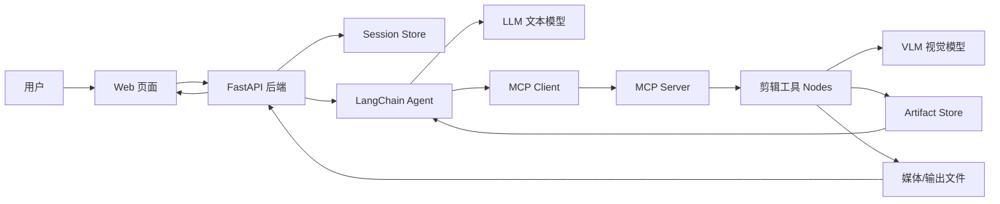
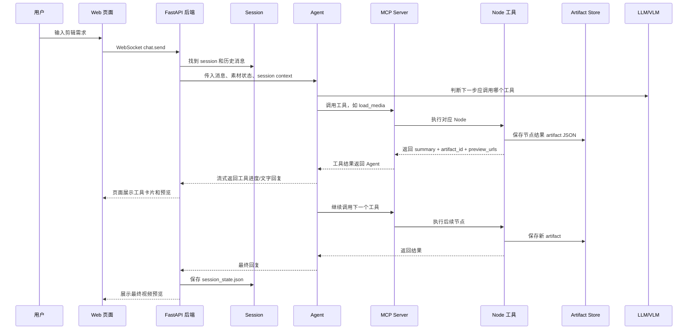

# OpenStoryline System Logic

这份文档只讲系统逻辑，不讲 Python 语法。

目标是回答：

- 一条用户消息进入系统后，经过哪些模块？
- Web 页面、后端、Agent、MCP、工具节点、存储分别负责什么？
- 有哪些接口？
- 中间结果如何保存和复用？
- 为什么二次编辑能只重跑一部分节点？

---

## 1. 一句话架构

OpenStoryline 可以理解为：

```text
Web 聊天页面
  -> FastAPI 会话服务
  -> LangChain Agent
  -> MCP 工具服务
  -> 剪辑节点 Nodes
  -> 文件和 artifact 存储
  -> 返回工具进度与最终视频
```

它不是一个单纯聊天机器人。它的核心是：

```text
LLM 负责决策和调度
Nodes 负责实际剪辑能力
ArtifactStore 负责保存每一步结果
Session 负责把多轮对话串起来
```

---

## 2. 架构总览



### 各模块职责

| 模块 | 负责什么 | 不负责什么 |
| --- | --- | --- |
| Web 页面 | 展示聊天、上传素材、展示工具卡片、预览视频 | 不直接剪辑视频 |
| FastAPI 后端 | 管理会话、上传文件、WebSocket 流式聊天、预览本地文件 | 不直接决定剪辑策略 |
| LangChain Agent | 读用户意图、决定调用哪个工具、组织多轮工具调用 | 不直接处理视频帧 |
| MCP Client | 把 Agent 的工具调用发给 MCP Server | 不实现具体工具 |
| MCP Server | 注册工具、接收工具调用、创建 NodeState | 不决定调用顺序 |
| Nodes | 实际执行加载、切分、理解、筛选、文案、BGM、时间线、渲染 | 不管理 Web 会话 |
| Artifact Store | 保存每个节点的 JSON 结果，供后续复用 | 不做业务决策 |
| Media/Outputs | 保存上传素材、预览文件、最终视频 | 不知道 Agent 逻辑 |

---

## 3. 一次用户请求的时序图



---

## 4. 主流程伪代码

### 4.1 页面发消息

```text
用户在页面输入 prompt
页面通过 WebSocket 发给后端
后端找到 session
后端把 prompt 加入消息历史
后端调用 Agent
Agent 开始思考并选择工具
每次工具调用都会返回进度
后端把进度实时推给页面
Agent 完成后，后端保存 session
页面展示最终回复和预览
```

### 4.2 Agent 调工具

```text
Agent 看到用户目标
Agent 查看已有历史和工具列表

如果没有素材索引：
  调用 load_media

如果素材还没切分：
  调用 split_shots

如果没有画面描述：
  调用 understand_clips

如果用户要求筛选：
  调用 filter_clips

如果需要组织叙事：
  调用 group_clips

如果需要字幕/文案：
  调用 generate_script

如果需要字体/花字：
  调用 elementrec_text

如果需要 BGM：
  调用 select_bgm

如果需要转场：
  调用 elementrec_transition

如果不要配音：
  调用 generate_voiceover(mode=skip)
否则：
  调用 generate_voiceover(mode=auto)

调用 plan_timeline_pro 组织时间线
调用 render_video 输出 mp4
```

注意：实际不是硬编码成这段 if-else，而是由 LLM Agent 根据工具描述、历史结果和用户请求来决定。上面只是逻辑等价的伪代码。

---

## 5. 接口地图

这些接口来自后端 FastAPI。它们是页面和后端沟通的主要入口。

### 5.1 页面和静态资源

| 接口 | 作用 |
| --- | --- |
| `GET /` | 返回 Web 主页面 |
| `GET /node-map` | 返回节点地图页面 |
| `/static/*` | 前端 JS/CSS/图片资源 |
| `/node_map/*` | 节点地图静态资源 |

### 5.2 元信息接口

| 接口 | 作用 |
| --- | --- |
| `GET /api/meta/tts` | 返回 TTS 配置 UI schema |
| `GET /api/meta/ai_transition` | 返回 AI 转场配置 UI schema。注意 v1.0.1 镜像未必支持新版配置 |

### 5.3 会话接口

| 接口 | 作用 |
| --- | --- |
| `POST /api/sessions` | 创建一个新剪辑会话，返回 `session_id` |
| `GET /api/sessions/{session_id}` | 获取会话状态、历史、素材等信息 |
| `POST /api/sessions/{session_id}/clear` | 清空当前会话聊天历史 |
| `POST /api/sessions/{session_id}/cancel` | 中断当前正在执行的回复/工具调用 |

### 5.4 素材上传接口

| 接口 | 作用 |
| --- | --- |
| `POST /api/sessions/{session_id}/media` | 普通上传文件 |
| `POST /api/sessions/{session_id}/media/init` | 初始化分片上传 |
| `POST /api/sessions/{session_id}/media/{upload_id}/chunk` | 上传一个分片 |
| `POST /api/sessions/{session_id}/media/{upload_id}/complete` | 完成分片上传 |
| `POST /api/sessions/{session_id}/media/{upload_id}/cancel` | 取消分片上传 |
| `GET /api/sessions/{session_id}/media/pending` | 查看待发送素材 |
| `DELETE /api/sessions/{session_id}/media/pending/{media_id}` | 删除一个待发送素材 |
| `GET /api/sessions/{session_id}/media/{media_id}/thumb` | 获取素材缩略图 |
| `GET /api/sessions/{session_id}/media/{media_id}/file` | 获取上传素材原文件 |

### 5.5 预览接口

| 接口 | 作用 |
| --- | --- |
| `GET /api/sessions/{session_id}/preview?path=...` | 把工具返回的本地路径转换成浏览器可访问的预览 URL |

它允许预览的路径范围主要包括：

```text
session media_dir
outputs_dir
bgm_dir
.server_cache
```

所以工具返回 `/app/.../output.mp4` 后，页面通过这个接口播放视频。

### 5.6 聊天 WebSocket

| 接口 | 作用 |
| --- | --- |
| `WS /ws/sessions/{session_id}/chat` | 页面和 Agent 的主通信通道，负责发送用户消息、接收流式回复和工具进度 |

---

## 6. 存储地图

OpenStoryline 的存储可以分成四类。

### 6.1 上传素材

逻辑路径来自配置：

```text
project.media_dir = ./outputs/media
```

实际运行时会按 session 隔离：

```text
outputs/media/{session_id}/media_0001.mp4
outputs/media/{session_id}/media_0002.mp4
...
```

页面上传后，素材先成为 pending media；当用户发出聊天请求时，Agent 可以通过 `load_media` 建立索引。

### 6.2 会话状态

每个 session 会保存状态文件：

```text
outputs/{session_id}/session_state.json
```

里面保存：

```text
聊天历史
语言设置
待上传素材元信息
模型/服务配置摘要
前端恢复会话所需状态
```

### 6.3 节点结果 artifact

每个工具节点执行完，会保存 JSON 结果。

观察日志可见：

```text
/app/outputs/{session_id}/load_media/load_media_*.json
/app/outputs/{session_id}/split_shots/split_shots_*.json
/app/outputs/{session_id}/generate_script/generate_script_*.json
...
```

每次工具返回一个：

```text
artifact_id
```

后续工具或 Agent 可以通过：

```text
read_node_history(query_artifact_id)
```

读取之前节点结果。

### 6.4 渲染视频缓存

最终视频常出现在 server cache：

```text
/app/.storyline/.server_cache/{session_id}/render_video_xxx/output_xxx.mp4
```

工具结果会把这个路径放进：

```text
preview_urls
```

页面再通过 `/api/sessions/{session_id}/preview?path=...` 播放它。

---

## 7. 能力模块地图

| 能力 | 工具/节点 | 输入 | 输出 |
| --- | --- | --- | --- |
| 素材加载 | `load_media` | 上传素材路径 | 媒体索引、素材清单 |
| 镜头切分 | `split_shots` | 已加载视频 | clip 列表、起止时间 |
| 内容理解 | `understand_clips` | clip + 抽帧 | 每个 clip 的文字描述、整体描述 |
| 镜头筛选 | `filter_clips` | clip 描述 + 用户要求 | 选中的 clip 列表 |
| 片段分组 | `group_clips` | 选中 clip + 排序要求 | 叙事分组 |
| 文案生成 | `generate_script` | 分组 + 风格要求 | 标题、字幕文本 |
| 文案模板推荐 | `script_template_rec` | 风格要求 | 参考模板/风格线索 |
| 字幕样式 | `elementrec_text` | 审美要求 | 字体、颜色等文本样式 |
| 背景音乐 | `select_bgm` | 情绪/节奏要求 | BGM 文件 |
| 首尾淡入淡出 | `elementrec_transition` | mode、duration | 整条成片的 fade_in、fade_out 配置 |
| 配音 | `generate_voiceover` | 字幕文案 | 音频，或 skip 结果 |
| 时间线 | `plan_timeline_pro` | 素材、文案、BGM、转场、配音 | 时间线 JSON |
| 渲染 | `render_video` | 时间线 | mp4 文件 |
| 历史读取 | `read_node_history` | artifact_id | 指定节点历史结果 |
| Skill 写入 | `write_skills` | skill 名称和内容 | 本地 Skill 文件 |

---

### 7.1 某次真实剪辑的 MCP 调用顺序

这一节记录的是一次真实剪辑中实际发生的 MCP tool 调用顺序，不解释模型为什么这样选。

真实用户请求：

```text
基于我上传的这个素材，做一个 5 秒测试视频。不要联网搜素材，不要配音。现在开始。
```

真实 session：

```text
e78297ae266440caac2cac2dc5575c51
```

真实 HTTP trace：

```text
C:\Users\guoyueting\agent\FireRed-OpenStoryline\outputs\e78297ae266440caac2cac2dc5575c51\debug\llm_http_trace.jsonl
```

注意：

```text
下面只列 MCP tool_calls。
trace 中间还有 VLM/节点内部采样请求，它们的 finish_reason 是 stop，不算 MCP tool 调用。
```

实际 MCP tool call 顺序：

| 顺序 | HTTP 行 | Tool | Arguments | 对应产物/说明 |
| --- | --- | --- | --- | --- |
| 1 | request 1 / response 2 | `storyline_load_media` | `{"mode": "auto"}` | 索引当前 session 的上传素材，生成 `load_media` artifact |
| 2 | request 3 / response 4 | `storyline_split_shots` | `{"mode": "auto"}` | 基于 `load_media` artifact 生成 `clips`，生成 `split_shots` artifact |
| 3 | request 5 / response 6 | `storyline_understand_clips` | `{"mode": "auto"}` | 对 clips 做视觉理解，期间会触发 VLM 请求 |
| 4 | request 15 / response 16 | `storyline_filter_clips` | `{"mode": "auto", "user_request": "这是测试视频，保留全部片段，不要丢弃任何素材。"}` | 筛选/保留片段 |
| 5 | request 19 / response 20 | `storyline_group_clips` | `{"mode": "auto", "user_request": "按一天的时间顺序排列：早晨咖啡 → 城市漫步 → 日落休闲。"}` | 排序并分组 clips |
| 6 | request 23 / response 24 | `storyline_generate_script` | `{"mode": "auto", "user_request": "极简 Vlog 风格的短文案，口语、轻松，配合三个章节标题：早晨咖啡、城市漫步、日落休闲。"}` | 生成字幕/文案 |
| 7 | request 27 / response 28 | `storyline_elementrec_text` | `{"mode": "auto", "user_request": "极简、干净的字体风格，适合 Vlog 标题。"}` | 推荐字幕字体/样式 |
| 8 | request 31 / response 32 | `storyline_elementrec_transition` | `{"mode": "auto", "duration": 500}` | 生成整条成片首尾各 500ms 的淡入淡出配置 |
| 9 | request 33 / response 34 | `storyline_generate_voiceover` | `{"mode": "skip"}` | 按用户要求跳过配音 |
| 10 | request 35 / response 36 | `storyline_select_BGM` | `{"mode": "auto", "user_request": "轻松、治愈的 Vlog 背景音乐，节奏舒缓。"}` | 这一步返回了一个大写 BGM 的 tool name |
| 11 | request 37 / response 38 | `storyline_select_bgm` | `{"mode": "auto", "user_request": "轻松、治愈的 Vlog 背景音乐，节奏舒缓。"}` | 实际 BGM 选择 |
| 12 | request 41 / response 42 | `storyline_plan_timeline_pro` | `{"mode": "auto"}` | 组织时间线 |
| 13 | request 43 / response 44 | `storyline_render_video` | `{"mode": "auto"}` | 渲染成片 |

后续阅读顺序可以按这条链路逐个模块看：

```text
load_media
-> split_shots
-> understand_clips
-> filter_clips
-> group_clips
-> generate_script
-> elementrec_text
-> elementrec_transition
-> generate_voiceover
-> select_bgm
-> plan_timeline_pro
-> render_video
```

---

### 7.2 load_media 详细流程

`load_media` 的完整说明见：

```text
architecture/01-load-media-flow.md
```

核心结论：

```text
LLM 只返回 storyline_load_media {"mode":"auto"}；
文件路径不由 LLM 传入；
后端通过 session_id 定位 media_dir；
load_media 前置拦截器扫描该 session 的全部素材文件；
load_media 节点把文件索引成 media_0001 / media_0002 / media_0003。
```

---

### 7.3 split_shots 详细流程

`split_shots` 的完整说明见：

```text
architecture/02-split-shots-flow.md
```

核心结论：

```text
TransNetV2 负责判断哪里应该切；
ffmpeg 负责按切点真正切出视频片段；
OpenStoryline 把片段包装成 clips JSON，并保存成 split_shots artifact。
```

---

### 7.4 understand_clips 详细流程

`understand_clips` 的完整说明见：

```text
architecture/03-understand-clips-flow.md
```

核心结论：

```text
understand_clips 读取 load_media 和 split_shots 的结果；
对每个 clip 分别调用视觉模型，生成 caption 和 aes_score；
再调用一次文本模型生成全部 clips 的 overall 描述；
结果保存为 understand_clips artifact，并将执行摘要返回 Agent LLM。
```


---

### 7.5 filter_clips 详细流程

`filter_clips` 的完整说明见：

```text
architecture/04-filter-clips-flow.md
```

核心结论：

```text
filter_clips 读取 split_shots 和 understand_clips 的结果；
根据 Agent 整理出的 user_request 和每个 clip 的 caption 生成保留判断；
程序将 keep=true 的有效 clip_id 整理为 selected；
它不删除视频文件，只决定后续节点采用哪些 clips。
```


---

### 7.6 group_clips 详细流程

`group_clips` 的完整说明见：

```text
architecture/05-group-clips-flow.md
```

核心结论：

```text
group_clips 只读取 filter_clips 已选中的 clips；
根据 Agent 整理出的 user_request、caption 和 duration 生成叙事分组；
groups 中 clip_ids 的排列顺序就是后续采用的逻辑顺序；
它只生成结构，不在这一阶段拼接或修改视频文件。
```


---

### 7.7 generate_script 详细流程

`generate_script` 的完整说明见：

```text
architecture/06-generate-script-flow.md
```

核心结论：

```text
generate_script 组合 group_clips 的叙事结构、understand_clips 的画面语义和 split_shots 的时长；
Agent LLM 提供文案风格，节点内部 LLM 为每个 group 生成 raw_text 和视频标题；
程序再按标点把 raw_text 拆成 subtitle_units；
生成 script 不等于生成配音，script 也可以只作为字幕使用。
```


---

### 7.8 elementrec_text 详细流程

`elementrec_text` 的完整说明见：

```text
architecture/07-elementrec-text-flow.md
```

核心结论：

```text
elementrec_text 先从本地 font_info.json 形成字体候选；
Agent LLM 提供审美方向，节点内部 LLM 根据字幕和候选元数据选择 font_name；
程序为选择结果补充 font_color；
节点只生成字体配置，真正加载字体并绘制字幕发生在后续渲染阶段。
```

---

### 7.9 elementrec_transition 详细流程

`elementrec_transition` 的完整说明见：

```text
architecture/08-elementrec-transition-flow.md
```

核心结论：

```text
Agent LLM 只传入 mode 和 duration，后端自动补入 group_clips 依赖；
当前节点不读取分组内容，也不调用内部 LLM；
mode=auto 时固定生成整条成片开头的 fade_in 和结尾的 fade_out；
真正的淡入淡出在 render_video 拼接完整条视频后应用，不发生在相邻 clips 之间。
```

---

## 8. 为什么二次编辑能复用结果

核心原因是：每个工具节点的输出都会被保存成 artifact。

第一次完整剪辑时产生：

```text
load_media artifact
split_shots artifact
understand_clips artifact
filter_clips artifact
group_clips artifact
generate_script artifact
elementrec_text artifact
select_bgm artifact
elementrec_transition artifact
plan_timeline_pro artifact
render_video artifact
```

第二次用户说：

```text
字幕更小红书，音乐更活力，节奏更快
```

Agent 判断：

```text
素材没变 -> 不需要 load_media
镜头没变 -> 不需要 split_shots
画面理解没变 -> 不需要 understand_clips
筛选和分组大体可复用 -> 不需要 filter/group
文案风格变了 -> 重跑 generate_script
字幕风格变了 -> 重跑 elementrec_text
音乐要求变了 -> 重跑 select_bgm
转场/节奏变了 -> 重跑 transition/timeline/render
```

第三次用户说：

```text
只把字幕文案改正式，音乐、转场和节奏不要变
```

Agent 判断：

```text
只需要新文案
需要把新文案放回时间线
需要重新渲染
不需要重新选择音乐/转场/素材
```

实际日志验证：

```text
generate_script
read_node_history
plan_timeline_pro
read_node_history
render_video
```

这说明复用能力不是凭空发生的，而是基于：

```text
session_id
artifact_id
read_node_history
节点输出文件
Agent 对用户意图的判断
```

---

## 9. 逻辑层级伪代码

```text
function handleUserMessage(session_id, user_message):
    session = loadSession(session_id)
    media_state = scanSessionMedia(session_id)
    history = session.chat_history

    agent_input = {
        user_message,
        history,
        media_state,
        available_tools,
        previous_artifacts
    }

    while agent_not_done:
        decision = LLM.decide_next_action(agent_input)

        if decision.type == "reply":
            streamReplyToWeb(decision.text)
            saveSession(session)
            return

        if decision.type == "tool_call":
            tool_result = MCP.call_tool(
                name = decision.tool_name,
                args = decision.args,
                session_id = session_id
            )

            saveArtifact(tool_result)
            streamToolCardToWeb(tool_result)
            agent_input.history.append(tool_result)

    saveSession(session)
```

```text
function runNode(session_id, node_name, args):
    previous_outputs = loadArtifacts(session_id)
    node_state = {
        session_id,
        artifact_id,
        language,
        llm_or_vlm_access,
        previous_outputs,
        file_paths
    }

    result = node.execute(node_state, args)
    artifact_id = saveResult(session_id, node_name, result)

    return {
        artifact_id,
        user_summary,
        llm_summary,
        preview_urls
    }
```

---

## 10. 当前已验证的系统行为

通过实验已验证：

```text
1. Web 上传素材成功
2. Agent 能调用 load_media / split_shots / understand_clips 等工具
3. VLM 能识别测试素材性质
4. Agent 能完整生成视频
5. Agent 能在同一 session 中二次编辑
6. Agent 能根据局部修改请求只重跑必要节点
7. 页面能通过 preview 接口播放生成视频
```

还未验证：

```text
1. 真实生活素材上的剪辑质量
2. Pexels 在线素材搜索
3. TTS 配音能力
4. 保存 Editing Skill
5. 自定义 BGM / 字体 / 文案模板
6. 新版 main 分支中的 AI 转场和 ASR 粗剪
```
---

## 11. Agent 如何把用户输入变成 MCP tool 调用

这一段只讲 Agent 决策核心，不讲 Python 语法细节。

真实 HTTP 请求/响应对照样本见：

```text
experiments/llm-http-request-response.md
```

注意：这里说的真实 HTTP trace 是 `llm_http_trace.jsonl`，不是 LangChain callback 层的 `llm_raw_trace.jsonl`。

### 11.1 不是单独的 intent classifier

目前没有看到独立的“意图分类器 -> 工作流规划器 -> 工具列表”的硬编码模块。

真实逻辑更像：

```text
用户输入
+ 系统提示词
+ 素材状态
+ 历史消息
+ 已有工具结果
+ 所有可用 tool schema
-> 发给 LLM
-> LLM 返回普通文本或 tool_calls
```

如果 LLM 返回 `tool_calls`，LangChain Agent 就执行对应工具。工具结果再作为 `ToolMessage` 回到上下文，下一轮继续让 LLM 决定下一步。

### 11.2 发给 LLM 的核心内容

一次真实 `chat_model_start` 中可以看到：

```text
messages:
- system: OpenStoryline 剪辑助理系统提示词
- system: User media upload status，例如本轮携带多少素材、素材库有多少视频/图片
- human: 用户原始请求

invocation_params.tools:
- storyline_load_media
- storyline_split_shots
- storyline_understand_clips
- storyline_filter_clips
- storyline_group_clips
- storyline_generate_script
- storyline_generate_voiceover
- storyline_select_bgm
- storyline_elementrec_transition
- storyline_elementrec_text
- storyline_plan_timeline_pro
- storyline_render_video
- storyline_read_node_history
- skills...
```

每个 tool 传给 LLM 的不是源码，而是：

```text
name
function description
JSON parameters schema
```

### 11.3 LLM 响应的关键结构

真实 Agent 层捕获到的响应形态：

```text
AIMessage.content:
  好嘞，我按这个思路走...现在开始，第一步先加载素材。

AIMessage.tool_calls:
  name: storyline_load_media
  args: {"mode": "auto"}
  id: call_00_...
```

这说明模型可以同时输出给用户看的自然语言，以及结构化工具调用。

最新 raw trace 也已经能直接看到同一层信息：

```text
llm_raw_trace.jsonl
-> event = llm_end
-> payload.response.generations[0][0].message.tool_calls

tool_calls:
- name: storyline_load_media
  args: {"mode": "auto"}
  id: call_00_m8YCIFZvRi6MgrUkGB1k8329
```

### 11.4 为什么模型知道先调 load_media

因为请求里同时包含三类导航信息：

```text
系统提示词：告诉它常规剪辑流程从 load_media 开始
素材状态：告诉它用户已经上传素材，不需要再问
工具描述：load_media 被描述为无依赖入口，且下游操作都依赖它
```

所以用户即使没有说“调用 load_media”，LLM 也会选择：

```text
storyline_load_media {"mode": "auto"}
```

### 11.5 一步一步，而不是一次性完整计划

观察到的行为是循环式：

```text
LLM 决定调用 load_media
-> 系统执行 load_media
-> 工具结果作为 ToolMessage 回到上下文
-> LLM 再决定 split_shots
-> 工具结果再回到上下文
-> LLM 再决定 understand_clips
```

这就是 Agent 的核心：不是把流程写死，而是让 LLM 在每一步根据当前上下文和工具结果继续选择下一步。

### 11.6 当前 trace 文件

为了学习这部分，当前本地源码加了临时 trace：

```text
outputs/<session_id>/debug/llm_raw_trace.jsonl
outputs/<session_id>/debug/llm_trace.jsonl
```

重点看：

```text
llm_raw_trace.jsonl:
  chat_model_start 看真实请求 messages/tools
  llm_end 看模型响应

llm_trace.jsonl:
  agent_model_input 看 Agent 视角输入
  agent_ai_message 看 AIMessage.tool_calls
  agent_tool_message 看工具结果如何回到上下文
```
